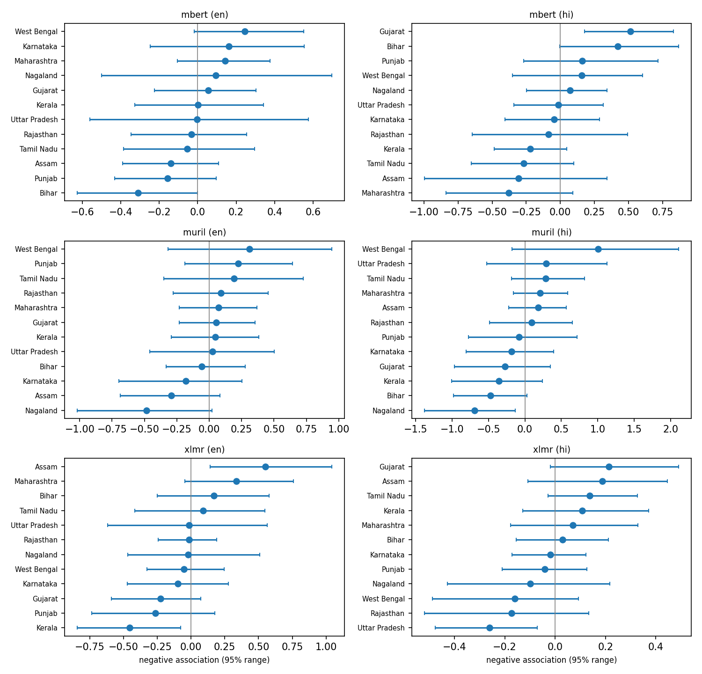

# Regional Bias Probe: English and Hindi

A small, reproducible probe of how multilingual masked language models associate Indian regional identities (states) with positive and negative personality words, in English and Hindi.

**Purpose:** Measuring model bias, not making claims about real people. The test sentences contain stereotype-style statements only as probe inputs.

## Questions

1. Do XLM-R, mBERT and MuRIL associate some regional identities more with negative words than others?
2. Do English and Hindi sentences give the same picture?
3. Are the results stable across sentence templates and across models?

## Method

- 12 regional identities × 20 attribute words (10 positive, 10 negative) × 2 templates × 2 languages = 960 sentences per model.
- For each sentence, mask the attribute word piece by piece and sum the log-probability the model gives to the original pieces.
- For each attribute, subtract the average score over identities to reduce the effect of word frequency.
- Negative association of an identity = mean negative-attribute score minus mean positive-attribute score, after that subtraction.
- 95% confidence ranges are calculated by resampling attributes 1,000 times.
- Checks: English vs Hindi agreement, template robustness, and agreement between models using Spearman correlation.

## Results

The full experiment was run using all three models: XLM-R, mBERT and MuRIL.

### Association scores



The plot shows negative association scores for each state, model and language. Positive values indicate relatively greater association with negative attributes, while negative values indicate relatively greater association with positive attributes.

The horizontal bars represent 95% bootstrap confidence intervals. Intervals crossing zero should not be interpreted as clear evidence of an association in either direction.

### Correlation checks

| Check | Model | Spearman correlation | p-value |
|---|---|---:|---:|
| English vs Hindi | mBERT | -0.077 | 0.812 |
| English vs Hindi | MuRIL | 0.552 | 0.063 |
| English vs Hindi | XLM-R | 0.091 | 0.779 |
| Template robustness (English) | mBERT | 0.881 | p < 0.001 |
| Template robustness (Hindi) | mBERT | 0.769 | 0.003 |
| Template robustness (English) | MuRIL | 0.636 | 0.026 |
| Template robustness (Hindi) | MuRIL | 0.748 | 0.005 |
| Template robustness (English) | XLM-R | 0.448 | 0.145 |
| Template robustness (Hindi) | XLM-R | 0.573 | 0.051 |

The complete model-agreement and correlation results are available in `results/correlations.csv`.

## What I found

The results suggest that regional associations are not consistent across models or languages. English-Hindi correlations were weak for mBERT and XLM-R, while MuRIL showed a moderate positive correlation, although it did not reach the conventional 0.05 significance threshold. Template robustness was strongest for mBERT in both languages, while XLM-R showed weaker consistency. Agreement between different models was generally weak, suggesting that the measured associations depend considerably on the model used. Overall, the results highlight how language choice, sentence construction and model architecture can influence the associations produced by multilingual language models.

Six out of the 72 model-language-state combinations had bootstrap confidence intervals that did not cross zero. These are exploratory observations, not confirmed findings. No multiple-comparison correction was applied.

## Limitations

- Only 12 regional identities, 20 attribute words and 2 templates per language were used.
- Hindi sentences were written by hand by one person (me).
- Word-probability probing is a weak proxy; it shows associations learned from text, not truth about people.
- Caste and religion are deliberately not included in this project.
- No claims are made about downstream harm.
- The results depend on the selected words and sentence templates. Different wording may produce different associations.
- Only three multilingual masked language models were tested.
- The sample size for correlation checks is small (12 states), so correlations should be interpreted cautiously.
- The 95% bootstrap intervals do not account for multiple comparisons.

## Status

**Completed:** Project setup, data preparation, small pipeline test, full experiment across all three models, and analysis.

**Generated outputs:**
- `results/scores.csv`
- `results/association.csv`
- `results/correlations.csv`
- `results/association.png`

The results and analysis are complete. Interpretation and further validation remain open to improvement.

## Reproduce

Install the dependencies:

```bash
pip install -r requirements.txt
```

Run a quick pipeline test:

```bash
python -m src.run_probe --small --models xlmr
python -m src.analyze --small
```

Run the full experiment:

```bash
python -m src.run_probe
python -m src.analyze
```

No dataset download or login is needed. All models are publicly available on Hugging Face and download automatically when first used.

## Credits

Models:
- XLM-RoBERTa (FacebookAI)
- Multilingual BERT (Google)
- MuRIL (Google, Apache-2.0)

